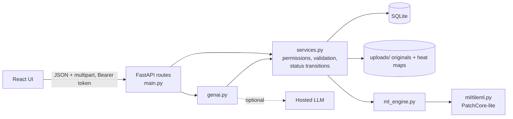
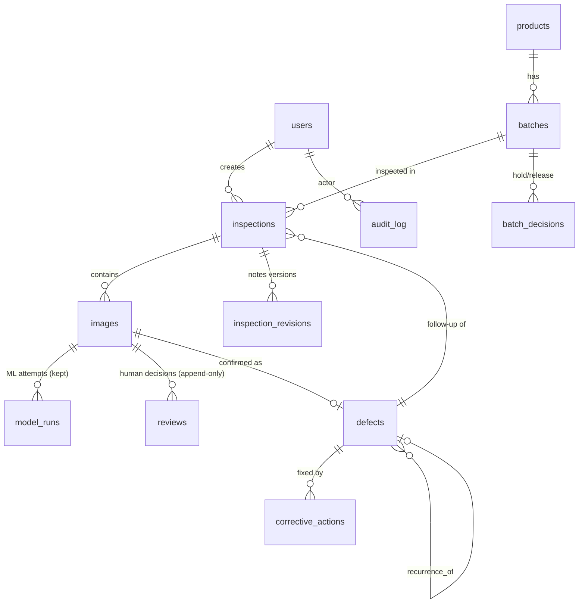

# Architecture

Rules live in `services.py` only. Routes are thin, so the same checks protect the API, the UI and the GenAI retrieval.

## Data model

* `model_runs` = machine output; `reviews` = human result. They are never merged. Current state is *derived* from review history (`review_state()`), so nothing is overwritten.
* Counting: items are `(batch, sample_ref)` of `item` images in original inspections. Surface / batch-sample images and follow-up inspections are reported separately and never inflate the defect rate.
* Defect rate = items with human-confirmed defect / items fully reviewed. AI flags are never in the numerator.

## Workflow and status rules
* Inspection: `draft -> submitted -> archived` (a draft with no evidence may be deleted; anything else is archived). Notes of a submitted inspection change only through numbered revisions with a reason.
* Image review state: `pending | needs_more_evidence | no_defect | defect_confirmed | disputed`. Two reviewers who disagree make it `disputed`; only a manager can resolve (resolution is a new row; the earlier reviews stay).
* Defect: `open -> awaiting_reinspection` (when all actions are done) `-> closed` (needs a follow-up inspection whose images are all reviewed clean) or `-> reopened`. `closed -> reopened` also allowed. Withdrawn defects (dispute resolved as no defect) stay stored.
* Action: `open -> in_progress -> done`, or `cancelled` (assigners only, with reason). `done` is final.
* Batch decision: hold / release by a manager only. Repeating the same decision is rejected; releasing with unreviewed items or open defects needs an explicit acknowledgement. Every decision stores the evidence counts at that moment.

## Permission matrix (server-side)
| Action | Inspector | Supervisor | Manager |
|---|---|---|---|
| Create/edit products, archive | - | - | yes |
| Create/edit batches | yes | - | yes (archive: manager only) |
| Create inspections, upload, submit | yes | only own follow-up inspections for defects assigned to them | yes |
| Review images (confirm/correct/more evidence) | yes | - | yes |
| Resolve disputes | - | - | yes |
| Assign actions, close/reopen defects | yes | - | yes |
| Update action status | - | own actions only | yes |
| Record batch hold/release | - | - | yes |
| See records | all | only defects/actions assigned to them (and their own follow-ups) | all |
Supervisor scoping also applies to the dashboard, search, files, audit history and the GenAI assistant.

## Failure handling
* Corrupt / unsupported / oversized / duplicate uploads are rejected with a specific code and message; accepted evidence is committed *before* ML runs.
* ML unavailable or crashing: a `failed` model run (with error text) is stored, priority = 100, UI says "manual review needed", and *Retry AI* creates attempt 2 while keeping attempt 1.
* Double submit: `Idempotency-Key` header on inspection creation; duplicate files in one inspection are refused; repeating a batch decision is refused.
* Network failure in the UI keeps form values and uploaded-file rows on screen with retry.

## GenAI grounding (see `backend/app/genai.py`)
1. Retrieval through `services.*` (same permission checks as the UI). 2. Counts/rates computed in code. 3. Citation tokens `[DEF-3] [ACT-7] [IMG-12] [INS-4] [BAT-2]` resolve to records. 4. Unreviewed AI flags are listed separately from confirmed defects. 5. Notes/uploads are quoted as data; the assistant has no write capability. 6. Optional LLM output is accepted only if all its citations exist in the retrieved evidence, otherwise the grounded template text is returned.
