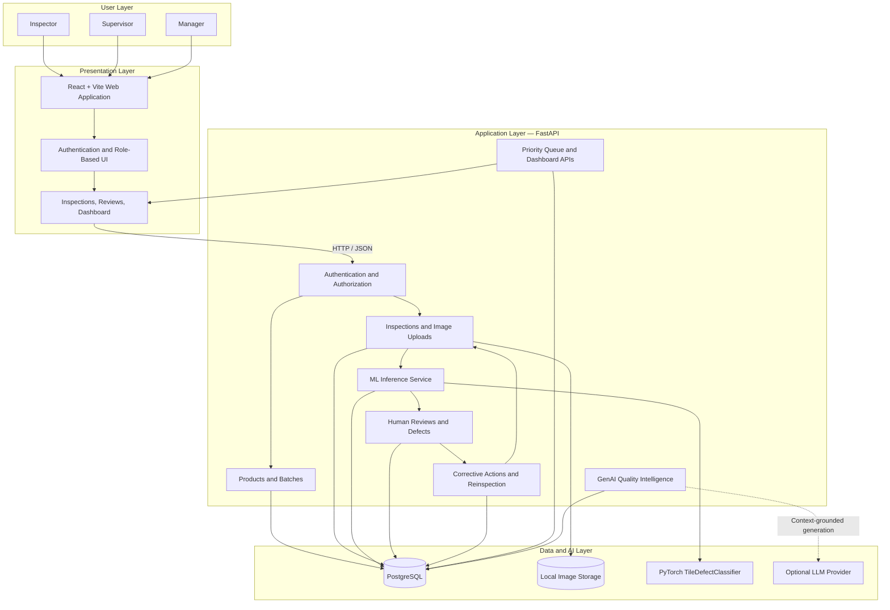
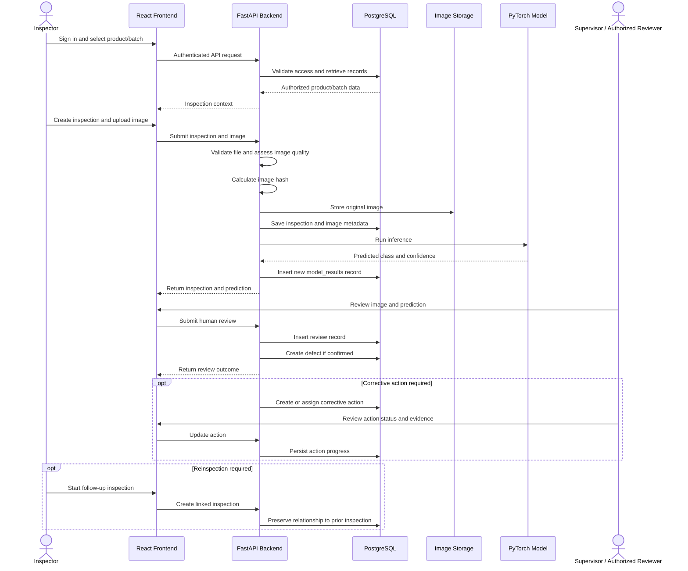
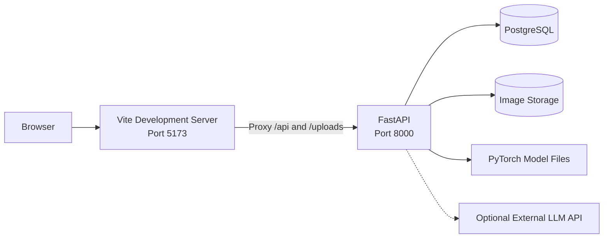

# Traceon — System Architecture

> **Traceon is an AI-assisted tile quality inspection and defect tracking platform that connects image-based defect detection with human verification, corrective action management, and traceable quality decisions.**

## 1. Architecture Overview

Traceon follows a modular, API-driven architecture that integrates a React frontend, a FastAPI backend, a PostgreSQL database, image storage, a PyTorch-based defect classification model, and an optional Large Language Model (LLM) for quality intelligence.

The architecture separates user interaction, business logic, data persistence, image processing, machine learning inference, and AI-generated assistance. This separation improves maintainability, traceability, security, and the ability to extend the system.

### High-Level Architecture

**Architecture principle:** the ML model provides predictions, humans make quality-review decisions, and authorized users manage corrective actions. GenAI assists with evidence-based explanations; it does not independently confirm defects or execute database commands.

---

## 2. Technology Stack

| Layer | Technology | Responsibility |
|---|---|---|
| Frontend | React | Interactive user interface and reusable components |
| Frontend tooling | Vite | Development server and production build |
| API communication | HTTP / JSON | Frontend-to-backend communication |
| API routing | Vite development proxy | Forwards `/api` and `/uploads` requests to FastAPI during development |
| Backend | Python + FastAPI | REST APIs, validation, authorization, and business logic |
| Database | PostgreSQL | Persistent application records, relationships, and audit information |
| ORM and migrations | SQLAlchemy and Alembic | Database access and schema evolution, where configured |
| Machine learning | PyTorch | Tile-defect classification |
| Image processing | OpenCV | Image preprocessing and quality checks, where implemented |
| Image storage | Local filesystem | Original inspection photographs and related image files |
| Authentication | JWT | Token-based authentication, when enabled in the application |
| Generative AI | Optional LLM provider | Evidence-grounded summaries and quality insights |
| Deployment | Docker Compose | Local multi-service orchestration, when configured |

*Note: The development proxy is not a production security boundary. Production routing, HTTPS, authentication, and access controls must be configured for the deployment environment.*

---

## 3. Application Components

### 3.1 Frontend — React + Vite

The frontend provides the primary interface for inspectors, supervisors, and managers. It communicates with the backend through HTTP APIs and displays information according to the authenticated user's permissions.

**Core responsibilities:**
- User registration and sign-in.
- Product and batch management.
- Inspection creation and image uploads.
- Model prediction results and image-quality indicators.
- Human review and defect confirmation.
- Corrective action assignment and progress tracking.
- Reinspection history and linked records.
- Dashboards, priority queues, and quality summaries.
- Access to GenAI-generated quality insights, when enabled.

During local development, Vite serves the application and proxies API and upload requests to the FastAPI backend at `http://127.0.0.1:8000`.

### 3.2 Backend — FastAPI

FastAPI is the central application layer. It coordinates validation, permissions, business rules, database operations, image storage, inference, and reporting.

| Backend module | Responsibility |
|---|---|
| Authentication | Registration, login, token handling, and identity verification |
| Authorization | Role and resource access checks |
| Products and batches | Product definitions, batch details, and traceability |
| Inspections | Inspection lifecycle, metadata, and image associations |
| Image processing | File validation, hashing, and image-quality assessment |
| ML inference | Preprocessing, classification, and prediction persistence |
| Reviews | Human verification, decisions, and review history |
| Defects | Confirmed defect records and lifecycle tracking |
| Corrective actions | Assignment, deadlines, status, and completion evidence |
| Reinspection | Follow-up inspection creation and linkage |
| Dashboard and priority queue | Aggregation of authorized quality records and prioritization |
| GenAI / RAG | Retrieval of authorized evidence and grounded natural-language responses |

The backend is responsible for enforcing business rules. The frontend must not be treated as the authority for permissions, defect status, or priority scores.

### 3.3 PostgreSQL — Structured Data

PostgreSQL stores the structured records needed to maintain a consistent inspection history and support reporting.

The logical data model includes the following entities, subject to the actual database schema:

| Entity | Purpose |
|---|---|
| Users | User identity, credentials metadata, and role information |
| Products | Product definitions and classification |
| Batches | Production batch details and product relationships |
| Inspections | Inspection metadata, status, and follow-up links |
| Images | Image references, hashes, storage paths, and quality metadata |
| Model results | Predictions, confidence scores, model versions, and current-result flags |
| Reviews | Human decisions, reviewer details, and review history |
| Defects | Confirmed defect records, categories, and resolution state |
| Corrective actions | Assigned work, deadlines, completion, and evidence |
| Audit records | Relevant historical events and accountability information |

Database relationships and exact field names should follow the implemented SQLAlchemy models and migrations.

**Data integrity principles:**
- Keep inspections, model results, reviews, and corrective actions as related but distinct records.
- Preserve the link between an inspection, its images, predictions, and human decisions.
- Record relevant timestamps and responsible users.
- Use database constraints and transactions to protect related updates.
- Preserve historical evidence rather than overwriting previous decisions.

### 3.4 Image Storage

Original inspection photographs are stored in the configured local filesystem, while PostgreSQL stores the associated metadata and storage references.

The image-handling workflow includes:
1. Validate the uploaded file and its allowed format and size.
2. Perform applicable image-quality checks.
3. Calculate a content hash to help identify identical files and verify integrity.
4. Store the original photograph in the configured storage location.
5. Persist the image reference and associated metadata.
6. Associate the image with its inspection and inference results.

**Important:** a hash supports integrity verification and duplicate detection; it does not, by itself, prove when an image was captured or establish who captured it.

Original images should remain available according to the configured retention policy. File access must be protected by authorization checks rather than relying only on an obscure storage path.

### 3.5 Machine Learning — Tile Defect Classification

Traceon uses a PyTorch-based `TileDefectClassifier` to analyze tile images and produce defect-classification predictions.

**Inference workflow:**
1. Receive an authorized inspection image.
2. Validate and preprocess the image using the configured preprocessing pipeline.
3. Load the trained model and perform inference.
4. Obtain the predicted class and associated confidence information.
5. Store the prediction, model version, and relevant metadata in a new `model_results` record.
6. Present the result to an authorized human reviewer.

When a new inference supersedes an earlier one, the intended design preserves the previous result and marks it as no longer current using `is_current=false`, while identifying the latest applicable result as current.

**Critical distinction:** an ML prediction is an indication, not a confirmed quality defect. The system requires a human review decision before treating a prediction as a confirmed defect.

The model's accuracy, supported defect classes, confidence calibration, and inference performance should be evaluated against the actual dataset and recorded evaluation results.

### 3.6 Human Review and Defect Management

Human review is a core control in Traceon's quality workflow.

The reviewer examines the original image, prediction, confidence information, and relevant inspection context before recording a decision.

Depending on the implemented review workflow, decisions may include confirming a defect, rejecting a prediction, or requesting further review.

A review is stored as a new record rather than silently replacing the earlier decision. A confirmed defect can then be associated with corrective action management.

This design supports:
- Human accountability.
- Review history and traceability.
- Comparison of model predictions with expert decisions.
- Investigation of disputed or recurring defects.
- Future analysis of model performance.

### 3.7 Corrective Actions and Reinspection

Corrective action management connects quality findings with follow-up work.

**Typical workflow:**
1. An authorized user assigns a corrective action for a confirmed defect.
2. The action receives an owner, status, deadline, and relevant details.
3. The responsible user records progress and completion evidence.
4. A follow-up inspection is created when reinspection is required.
5. The follow-up inspection links to the original inspection or defect.
6. The new inspection generates its own image and prediction records.
7. An authorized reviewer evaluates the new evidence.

**Completion is not the same as defect closure.** Marking a corrective action complete must not automatically close the underlying defect. Closure should follow the configured verification and approval rules.

This separation prevents administrative completion from being mistaken for proof that a quality issue has been resolved.

### 3.8 GenAI — Quality Intelligence

Traceon can integrate an optional LLM to explain quality records and support evidence-based investigation.

The GenAI component follows a retrieval-augmented generation (RAG) pattern:

1. Receive a user's quality-related question.
2. Verify the user's identity and permissions.
3. Retrieve relevant, authorized records through application-controlled database queries.
4. Prepare a limited context containing the applicable evidence.
5. Send that context to the configured LLM provider, if enabled.
6. Generate a natural-language response grounded in the retrieved evidence.
7. Return the response with appropriate references or identifiers, where supported.

Potential use cases include:
- Summarizing defects associated with a batch.
- Explaining why an inspection needs attention.
- Highlighting recurring defect categories.
- Summarizing overdue corrective actions.
- Helping users understand inspection and reinspection history.

**Safety and governance rules:**
- The LLM must not execute arbitrary SQL.
- Database access must remain under backend control.
- The LLM must not independently confirm defects or make batch acceptance decisions.
- Responses should distinguish recorded evidence from generated interpretation.
- Sensitive records must be filtered according to user permissions before being supplied as context.
- If the LLM is disabled or unavailable, core inspection and defect workflows should remain usable.

---

## 4. End-to-End Data Flow

The following sequence describes the intended inspection lifecycle.

### Lifecycle rules

1. Every inspection should have a traceable relationship to its batch and associated images.
2. New inference results should not erase previous predictions.
3. Human decisions must be distinguishable from model predictions.
4. Defects, corrective actions, and inspections must remain separate linked records.
5. Follow-up inspections should preserve the relationship to earlier evidence.
6. Dashboard and GenAI queries must respect user permissions.

---

## 5. Priority Queue and Risk-Based Triage

Traceon includes a rule-based priority-scoring mechanism intended to help authorized users focus on quality issues requiring attention.

### Priority rules

| Condition | Points |
|---|---:|
| Overdue corrective action | +100 |
| Reopened confirmed defect | +80 |
| Unresolved dispute | +70 |
| Recurring defect category within a batch | +40 |
| Pending human review | +30 |
| Poor image quality or uncertain result | +25 |

### Scoring model

For a record eligible for prioritization:

\[
S = 100O + 80R + 70D + 40B + 30H + 25Q
\]

Where each variable is either `1` when its condition applies or `0` otherwise:

- \(O\): overdue corrective action.
- \(R\): reopened confirmed defect.
- \(D\): unresolved dispute.
- \(B\): recurring defect category within a batch.
- \(H\): pending human review.
- \(Q\): poor image quality or uncertain result.

The total score is the sum of applicable rules. The priority queue can use this score to order records for review.

**Design constraints:**
- Scores must be calculated from stored evidence and explicit business rules.
- An unreviewed ML prediction must not be treated as a confirmed defect.
- Poor image quality may increase the need for attention but must not independently confirm a defect.
- The queue should provide the reasons contributing to each score.
- The score is a triage aid, not an automated product-acceptance or rejection decision.

*Implementation note: the formula above assumes each rule contributes at most once per scored record. If the implementation counts multiple events or uses a different aggregation strategy, document the actual behavior in the backend.*

---

## 6. Security and Access Control

Security is enforced primarily by the backend, with the frontend providing the corresponding user experience.

### Authentication and authorization
- Authenticate users before granting access to protected resources.
- Verify JWT signatures, expiry, and relevant claims when JWT authentication is implemented.
- Enforce role permissions on the backend for every protected operation.
- Apply resource-level authorization to products, batches, inspections, images, defects, and actions.
- Never rely on a role selected in a frontend form as proof of authorization.

### Data and file protection
- Validate uploaded file formats, sizes, and content.
- Prevent path traversal and unsafe file access.
- Restrict access to stored photographs and sensitive records.
- Use parameterized database operations and ORM safeguards.
- Store passwords using a suitable password-hashing algorithm.
- Keep database passwords, JWT secrets, and LLM API keys in environment variables or a secret manager.
- Never commit real credentials to GitHub.
- Use HTTPS and appropriate deployment security controls in production.

### Auditability
Record important actions such as inspection creation, prediction generation, human review, defect updates, corrective-action changes, and reinspection creation.

Audit records should identify the responsible user, event, timestamp, and relevant entity where supported by the schema.

---

## 7. API and Communication Boundaries

The React application communicates with FastAPI through HTTP endpoints, typically exchanging JSON for structured data and multipart requests for image uploads.

The development proxy is configured to forward:

| Frontend path | Backend target | Purpose |
|---|---|---|
| `/api/*` | `http://127.0.0.1:8000` | Application APIs |
| `/uploads/*` | `http://127.0.0.1:8000` | Upload or image-related routes, if exposed by the backend |

The exact API endpoint paths and HTTP methods should be documented from the implemented FastAPI routers.

A typical logical endpoint grouping includes authentication, products, batches, inspections, image uploads, inference, reviews, defects, corrective actions, dashboards, priority queues, and GenAI queries.

The proxy forwards requests; it does not itself implement authentication, authorization, or file security.

---

## 8. Error Handling and Operational Resilience

The application should handle failures at each layer without corrupting inspection history.

| Failure scenario | Expected handling |
|---|---|
| Invalid image upload | Reject the request and return a clear validation error |
| Poor image quality | Store applicable quality information and flag the need for attention |
| Model inference failure | Report the failure and avoid recording a fabricated prediction |
| Database failure | Return an appropriate error and preserve transactional consistency |
| Image-storage failure | Report the error and avoid creating misleading success records |
| LLM unavailable | Keep core inspection workflows available and report that AI assistance is unavailable |
| Unauthorized request | Reject access without exposing protected records |
| Reinspection failure | Preserve existing inspection history and report the failed operation |

Logs should support debugging while avoiding passwords, tokens, API keys, and unnecessary sensitive information.

---

## 9. Deployment Architecture

In a local development environment, the application typically runs as separate frontend and backend processes with PostgreSQL and image storage configured according to the project setup.

### Configuration requirements
- Frontend environment variables should contain only configuration appropriate for the browser.
- Database credentials and LLM secrets must remain server-side.
- PostgreSQL must be reachable from the backend.
- Model files and original images must be available to the backend at their configured paths.
- Database migrations should be applied before running application features that depend on the updated schema.
- Persistent volumes or backups should protect database records and image files in deployments that require durability.

If Docker Compose is used, its service names, ports, environment variables, and volumes should match the actual `docker-compose.yml` configuration.

---

## 10. Design Decisions and Innovation

### 10.1 Traceable inference history
New model predictions are stored as separate records, preserving the history of inference rather than silently overwriting previous results.

### 10.2 Human-in-the-loop quality decisions
Predictions guide inspection, but authorized human review determines whether a defect is confirmed.

### 10.3 Corrective action separated from defect closure
Completing a task does not automatically prove that the original defect has been resolved.

### 10.4 Linked reinspection
Follow-up inspections retain relationships with earlier inspections, supporting comparisons and historical investigations.

### 10.5 Evidence-based prioritization
The priority queue uses explicit rules and stored evidence to help teams identify overdue, disputed, recurring, or unreviewed quality issues.

### 10.6 Grounded GenAI assistance
The optional LLM summarizes authorized evidence while leaving database operations, access control, and quality decisions under application control.

### 10.7 Modular and extensible architecture
The separation of frontend, API, database, image storage, ML inference, and GenAI components allows individual modules to be maintained or upgraded without redesigning the entire application.

---

## 11. Future Enhancements

Potential extensions include:

- Object detection or segmentation for defect localization.
- Model version comparison and performance monitoring.
- More comprehensive audit trails and evidence exports.
- Batch-level trend analysis and recurring-defect analytics.
- Cloud object storage for large image collections.
- Background inference jobs for higher inspection throughput.
- Improved image-quality diagnostics and confidence calibration.
- Configurable priority thresholds and service-level targets.
- More extensive test coverage, monitoring, and deployment automation.

These are proposed enhancements and should not be interpreted as currently implemented features.

---

## 12. Architecture Summary

Traceon combines image-based machine learning with human verification and traceable corrective-action workflows. PostgreSQL maintains structured quality records, the filesystem retains original photographs, FastAPI enforces application logic and permissions, and React provides the user interface.

The optional GenAI layer supports natural-language investigation using authorized evidence, while the rule-based priority queue helps teams focus on important issues.

**The central architectural principle is simple: preserve the evidence, preserve the decision history, and keep automated predictions separate from confirmed quality decisions.**
