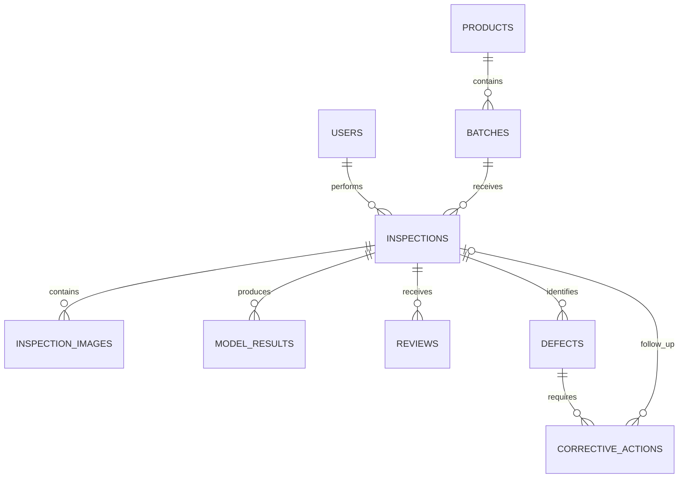

# Database Schema — Traceon

## Database Overview

- **Database:** `tile_quality_db`
- **DBMS:** PostgreSQL
- **Schema:** `public`
- **Migration tool:** Alembic

## Core Tables

| Table | Purpose |
|---|---|
| `users` | Stores user accounts, hashed passwords, and roles. |
| `products` | Stores tile product details, specifications, and archive status. |
| `batches` | Stores production batch details and links batches to products. |
| `inspections` | Records inspection sessions, inspectors, and inspection status. |
| `inspection_images` | Stores image paths, hashes, dimensions, and image-quality metadata. |
| `model_results` | Stores ML predictions, confidence scores, model versions, and current-result status. |
| `reviews` | Stores human review decisions, confirmed categories, and reviewer notes. |
| `defects` | Tracks confirmed defects, categories, severity, and status. |
| `corrective_actions` | Tracks corrective work, owners, deadlines, and follow-up inspections. |
| `batch_decisions` | Records batch hold, release, or conditional-release decisions. |
| `audit_history` | Maintains a history of important actions and quality-related changes. |
| `alembic_version` | Tracks the database migration version managed by Alembic. |

## Entity Relationships

*The diagram represents the intended logical relationships. Confirm the exact foreign keys against the implemented database schema.*

## Data Integrity and Traceability

- Foreign keys maintain relationships between products, batches, inspections, and quality records.
- Original inspection images and historical model results should be preserved.
- ML predictions remain separate from human review decisions and confirmed defects.
- Corrective-action completion does not automatically close a defect.
- Batch decisions and important changes should remain traceable.
- User authentication and role-based permissions protect sensitive operations.
